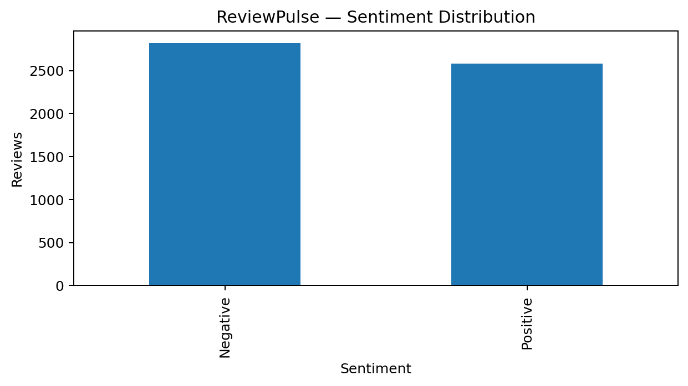
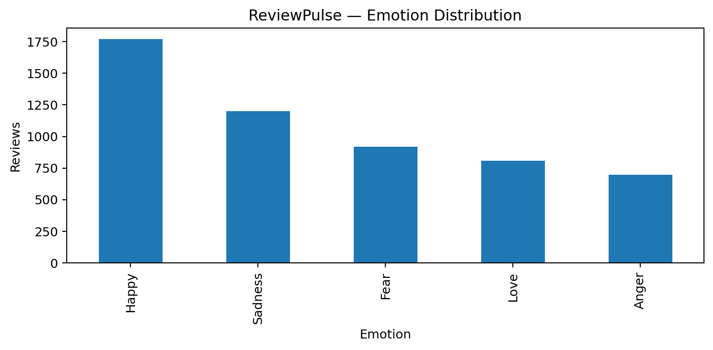
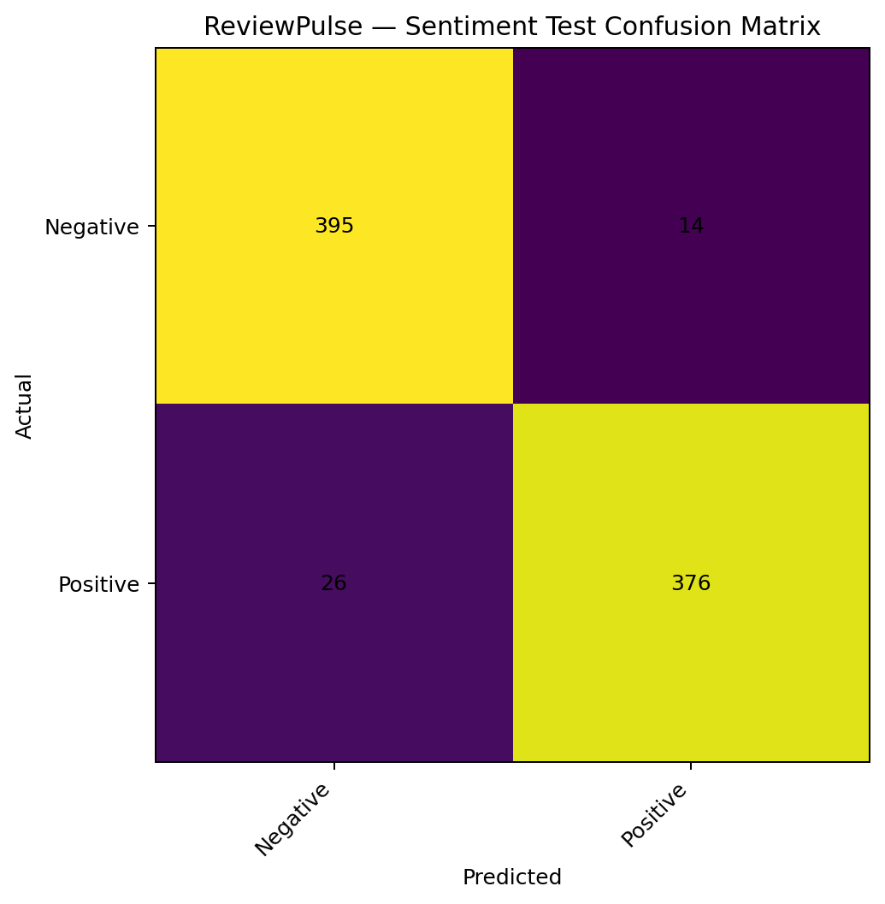
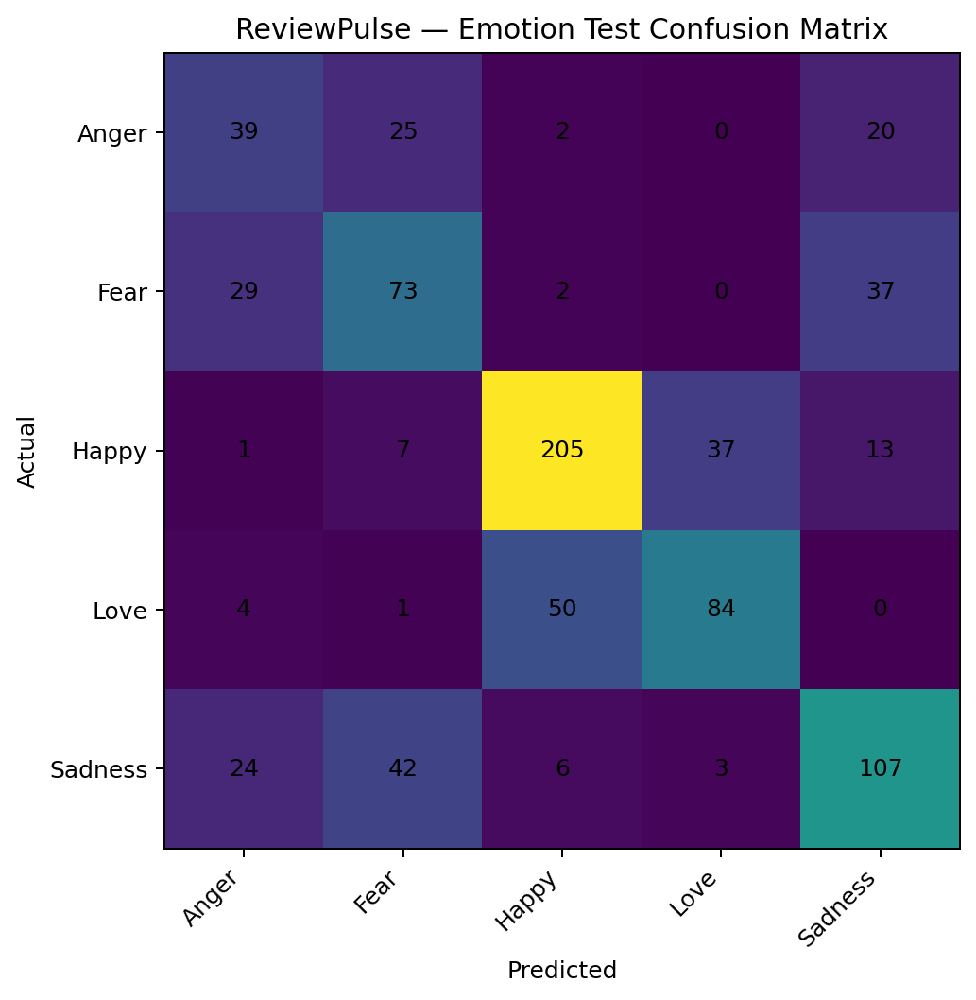
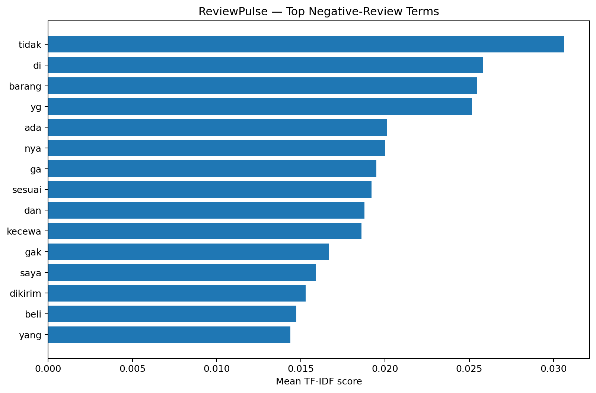
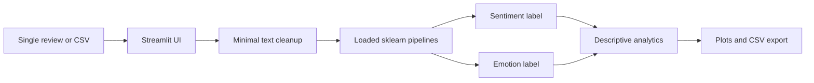

<div align="center">

# ReviewPulse 💬
### Indonesian E-commerce Review Intelligence

**Sentiment classification · Emotion classification · Review exploration · Reproducible ML research**

[](https://www.python.org/)
[](https://streamlit.io/)
[](https://scikit-learn.org/)
[](LICENSE)

**Day 15/100 · Research-backed portfolio prototype · Not a production-validated decision system**

[Quick Start](#quick-start) · [Results](#model-evaluation) · [Visual Evidence](#visual-evidence) · [Roadmap](#roadmap) · [Agent Guide](AGENTS.md)

</div>

> **Source of truth.** This document describes the publicly committed `main` branch of [MENSTRUE/ReviewPulse](https://github.com/MENSTRUE/ReviewPulse), inspected on 22 October 2026. Experiment results are sourced from [`reports/final_summary.json`](reports/final_summary.json), [`reports/official_test_metrics.json`](reports/official_test_metrics.json), [`reports/model_selection.json`](reports/model_selection.json) and [`reports/source_audit.json`](reports/source_audit.json). If a headline conflicts with these machine-generated artifacts, **check the experimental artifact and training protocol before changing the headline**. The repository currently does not include the complete training notebook; independent end-to-end retraining is **not yet demonstrated**.

---

## 1. Executive summary

Online sellers receive customer reviews but cannot efficiently read every comment, compare emotional patterns or identify repeated complaints. ReviewPulse is a Python/Streamlit research prototype that uses **two fitted text-classification pipelines** to assign a **sentiment** and **emotion** label to Indonesian product-review text. It supports single-review inference, CSV batch scoring, descriptive distributions, lexical keyword frequency, and CSV export.

The app is **not** a psychological emotion detector, a verified root-cause engine, or proof that customer satisfaction or revenue increases after using it. Predictions should support human review—not replace it.

### What works today

| Area | Current implementation | Evidence / code |
|---|---|---|
| Sentiment | `Positive` / `Negative` classification | [`models/reviewpulse_sentiment_tfidf.joblib`](models/reviewpulse_sentiment_tfidf.joblib), [`src/reviewpulse/inference.py`](src/reviewpulse/inference.py) |
| Emotion | `Happy`, `Sadness`, `Fear`, `Love`, `Anger` classification | [`models/reviewpulse_emotion_tfidf.joblib`](models/reviewpulse_emotion_tfidf.joblib) |
| Single review | Text input and predictions | [`app/streamlit_app.py`](app/streamlit_app.py) |
| CSV analysis | Select a review-text column, limit rows, batch predict and export | [`app/streamlit_app.py`](app/streamlit_app.py) |
| Analytics | Processed/skipped counts and predicted class frequencies | [`src/reviewpulse/analytics.py`](src/reviewpulse/analytics.py) |
| Visualization | Sentiment/emotion bars and donuts, frequent terms | [`src/reviewpulse/visualization.py`](src/reviewpulse/visualization.py) |
| Tests | Basic preprocessing and inference tests exist | [`tests/`](tests/) |

**Not yet verified:** externally hosted deployment, CI passing on GitHub, independent reproduction of model training from only this repository, calibrated probabilities for both models, or validation on fresh marketplace data.

## 2. Before — Now — Next

| Phase | State | Meaning |
|---|---|---|
| **Before — problem and experiment** | Research performed | Audit PRDECT-ID, group-aware split, candidate-model comparison, model evaluation, visual analysis on Kaggle. |
| **Now — reproducible inference prototype** | Available in repository | Two committed scikit-learn model artifacts, modular inference, Streamlit UI, JSON reports, plots and basic tests. Training notebook and full raw dataset are not committed. |
| **Next — reliability and product validation** | Planned, not shipped | Commit reproducible research notebook, pin environment, expand tests, perform external holdout evaluation, audit emotion labels, improve data privacy and production deployment. |

This roadmap separates **planned capabilities** from completed evidence. A commit or notebook save does not by itself establish production quality.

## 3. Product context and scope

**Intended users:** Indonesian marketplace sellers, UMKM operators, and customer-operations teams who need an initial overview of review text. Input can be one review or a CSV with a review column. Outputs include predicted categories, optional model probability where available, descriptive plots and an export.

**In scope:** Indonesian e-commerce product reviews; two supervised classification tasks; lexical keyword counts; descriptive aggregation. **Out of scope:** causal diagnosis, fraud detection, identity inference, individual mental-state assessment, automated customer-service action, business KPI impact, and universal language/domain support.

### Inference contract

`predict_review(text)` returns a dictionary with cleaned review, sentiment, emotion, optional sentiment/emotion confidence, and processing status. `predict_reviews(texts)` returns a pandas DataFrame with one row per input, including empty inputs flagged as `status="empty"`. Empty rows are **skipped**, not assigned an invented label. The fitted TF-IDF vectorizers live *inside* the saved sklearn pipelines: do not independently fit a new vectorizer during inference.

The sentiment champion is **LinearSVC**, so its decision margin **must not be presented as a probability**. The emotion champion uses LogisticRegression, whose `predict_proba` is a **model-estimated probability**, not evidence of calibration or certainty.

## 4. Dataset and provenance

**Research dataset:** *Product Reviews Dataset for Emotions Classification Tasks — Indonesian (PRDECT-ID).* The experiment loaded the dataset in Kaggle from:

```text
/kaggle/input/datasets/loliwibu/product-reviews-dataset/
  Product Reviews Dataset for Emotions Classification Tasks - Indonesian (PRDECT-ID) Dataset/
    PRDECT-ID Dataset.csv
```

This is an environment-specific input path, **not** a download endpoint. The raw CSV is not included in this repository. Obtain the dataset through its original distributor, check its license/terms independently, and do not assume that this repository's MIT license covers the data.

### Source audit — recorded results

| Property | Recorded value |
|---|---:|
| Rows / columns | **5,400 / 11** |
| Missing cells | **0** |
| Exact full-row duplicates | **7** |
| Rows with repeated review text (`duplicated`) | **95** |
| Unique raw review strings | **5,305** |
| Sentiment labels | Negative: **2,821**; Positive: **2,579** |
| Emotion labels | Happy: **1,770**; Sadness: **1,202**; Fear: **920**; Love: **809**; Anger: **699** |

Source columns: `Category`, `Product Name`, `Location`, `Price`, `Overall Rating`, `Number Sold`, `Total Review`, `Customer Rating`, `Customer Review`, `Sentiment`, `Emotion`.

The full training notebook's duplicate-label audit additionally identified **25 repeated texts with conflicting emotion labels** and **0 with conflicting sentiment labels** (in the exact-text grouping used by that audit). Such ambiguity is relevant to the lower emotion score. It does not prove the labels are wrong without manual annotation review.

### Split and leakage policy

The Kaggle experiment grouped normalized `Customer Review` text before splitting, then used approximately **70% train / 15% validation / 15% test**: **3,782 / 807 / 811 reviews**. Model selection used **validation macro-F1**; reported final results use the held-out **811-example internal test split**. Identical normalized review text must not cross split boundaries. This is **internal dataset evaluation**, not independent external-marketplace validation.

To reproduce training exactly, publish the complete source notebook/code, record input dataset version/checksum, dependency versions, random seed, split IDs, candidate hyperparameters, and training-artifact hashes. The committed repository currently lacks several of these artifacts; see [Reproducibility](#reproducibility).

## 5. Model evaluation

The two model winners were selected separately on validation macro-F1:

| Task | Validation-selected champion | Test accuracy | Test macro-F1 | Test balanced accuracy | Test N |
|---|---|---:|---:|---:|---:|
| **Sentiment** | TF-IDF + LinearSVC | **95.07%** | **95.07%** | **95.05%** | 811 |
| **Emotion** | TF-IDF + LogisticRegression | **62.64%** | **58.86%** | **58.86%** | 811 |

Raw test records: [`official_test_metrics.json`](reports/official_test_metrics.json). These percentages are rounded from source JSON; **they are not real-world service-level guarantees**. Macro-F1 weights classes equally and is more informative than accuracy when some emotion classes are less common. Sentiment is promising on this dataset; emotion requires more work, especially minority or ambiguous classes.

**Interpretation:** a good internal sentiment metric cannot establish generalization to a new platform, product category, language variation or time period. Do not claim the emotion model reliably detects a person's actual internal feelings. Do not choose a later model using this same test split and then call it untouched.

## 6. Visual evidence

All five figures below are **tracked repository assets** under `assets/`; they document **the research experiment**, not screenshots of a currently deployed UI.

### Dataset distributions





### Held-out test confusion matrices





### Exploratory negative-review terms



**How to read the figures:** a class distribution is not a predicted accuracy chart; confusion matrices describe mistakes on the reported test split; frequent TF-IDF words are **lexical associations**, not verified causal issue categories. When additional images are committed, update this gallery with **real paths**, not hypothetical screenshots.

## 7. Architecture and data flow



The repository intentionally separates presentation (`app/`), domain functions (`src/reviewpulse/`), trained models (`models/`), research evidence (`reports/`, `assets/`), and tests (`tests/`). The `src/reviewpulse/config.py` module resolves trusted local model paths. `inference.py` uses `joblib.load` and caches the models for reuse; **joblib/pickle is unsafe for untrusted artifacts**.

## 8. Repository structure (audited `main`)

```text
ReviewPulse/
├── .env.example
├── .gitignore
├── LICENSE
├── README.md                    # This document
├── AGENTS.md                    # Agent/contributor source-of-truth
├── app/
│   ├── __init__.py
│   └── streamlit_app.py
├── assets/
│   ├── dataset/
│   │   ├── sentiment_distribution.png
│   │   └── emotion_distribution.png
│   ├── evaluation/
│   │   ├── sentiment_test_confusion_matrix.png
│   │   └── emotion_test_confusion_matrix.png
│   └── predictions/
│       └── negative_review_top_terms.png
├── data/
│   └── README.md
├── docs/
│   ├── ARCHITECTURE.md
│   ├── EVALUATION.md
│   ├── LIMITATIONS.md
│   └── METHODOLOGY.md
├── models/
│   ├── README.md
│   ├── reviewpulse_sentiment_tfidf.joblib
│   └── reviewpulse_emotion_tfidf.joblib
├── notebooks/
│   └── README.md
├── pass/
│   └── README.md                # Security guidance, no actual passwords
├── reports/
│   ├── README.md
│   ├── final_summary.json
│   ├── model_selection.json
│   ├── official_test_metrics.json
│   └── source_audit.json
├── src/reviewpulse/
│   ├── __init__.py
│   ├── analytics.py
│   ├── config.py
│   ├── inference.py
│   ├── preprocessing.py
│   └── visualization.py
├── tests/
│   ├── __init__.py
│   ├── test_inference.py
│   └── test_preprocessing.py
├── pyproject.toml
└── requirements.txt
```

**Repository synchronization note:** `README.md`, `AGENTS.md`, and `pass/README.md` are introduced by this documentation update. The `notebooks/` directory currently contains a placeholder README, **not a committed training `.ipynb`**. Several `docs/*.md` files were empty at the audited commit and must not be treated as completed methodology documents. Report CSV files visible locally may be excluded by `.gitignore` and were **not present on remote `main`** when this was written.

## 9. Quick start

Requires Python 3.11+ and a supported set of scikit-learn/joblib dependencies compatible with the model artifacts. **Exact training-time dependency versions are not recorded in the currently committed requirements file.** If deserialization fails, restore the environment used to train/export the artifacts rather than loading unknown pickles or silently retraining.

```powershell
# Windows PowerShell — run from the directory containing ReviewPulse
 git clone https://github.com/MENSTRUE/ReviewPulse.git
 cd ReviewPulse
 py -3.11 -m venv .venv
 .\.venv\Scripts\python.exe -m pip install -r requirements.txt
 $env:PYTHONPATH = (Join-Path (Get-Location) 'src')
 .\.venv\Scripts\python.exe -m pytest -q
 .\.venv\Scripts\python.exe -m streamlit run app/streamlit_app.py
```

Open `http://localhost:8501`. The models must be available at the `models/` paths listed above (they are currently tracked in this repo). For users who avoid environment-variable setup, the Streamlit entry point adds `src/` to `sys.path`, but direct tests/imports still require package installation or `PYTHONPATH`.

### Example inputs

Positive: `Barang sesuai deskripsi, kemasan aman, pengiriman cepat.`

Negative: `Barang rusak saat diterima dan respons penjual sangat lambat.`

These are **examples to try**, not certified ground truths or guaranteed output classes.

### CSV input

At minimum, provide a header and a text column, e.g.:

```csv
review
"Barang bagus, sesuai foto."
"Ukuran tidak sesuai dan pengiriman terlambat."
```

Upload it in **Analisis CSV**, select the text column, choose maximum rows, and run inference. The export contains original selected columns plus model-produced prediction fields. Skipped/blank reviews must remain visibly skipped, never silently counted as valid reviews.

## 10. Reproducibility

**Inference reproducibility (partial):** the same committed artifacts and compatible library versions should yield deterministic class predictions for identical cleaned inputs. `src/reviewpulse/preprocessing.py` only performs NFKC Unicode normalization and whitespace cleanup, preserving lexical features expected by the stored TF-IDF pipelines. Loading `.joblib` with different scikit-learn versions may fail or change behavior; ensure provenance and trust.

**Training reproducibility (currently incomplete):** `notebooks/README.md` exists, but the full Kaggle research notebook is not yet tracked on `main`. To make full retraining auditable, commit the notebook, document Kaggle input dataset revision, train/validation/test IDs, seed, environment lockfile, grid/candidate comparisons, chosen metrics and dataset license. **Do not retroactively invent training runs or metrics**.

**Evidence precedence:** for existing reported numbers, inspect `reports/*.json` first; for runtime behavior, inspect `src/` and `app/`; for visuals, inspect the actual `assets/` files; for new experiments, add dated reproducible evidence without overwriting historical metrics.

## 11. Testing and quality checks

```powershell
$env:PYTHONPATH = (Join-Path (Get-Location) 'src')
python -m pytest -q
python -m compileall -q src app tests
python -m streamlit run app/streamlit_app.py
```

Manual smoke tests should cover: valid positive and negative reviews; empty/whitespace/`NaN` input; CSV with `review` and with custom column names; non-UTF-8 CSV error handling; duplicate column collisions; exports; missing/incorrect model files; label names; and absent confidence for the LinearSVC sentiment classifier. A passing import or unit test does **not** establish model accuracy or data safety.

**CI status:** no GitHub Actions workflow was present in the inspected tree. Running tests in CI and recording passing results remain roadmap items.

## 12. Deployment

**Local:** Streamlit runs with `python -m streamlit run app/streamlit_app.py`.

**Potential cloud setup (not claimed deployed):** choose a Streamlit-compatible host, provide compatible Python/scikit-learn versions, install requirements, make committed model artifacts available, set `PYTHONPATH=src` (or package the module), and use `app/streamlit_app.py` as the entry point. The app loads models from local paths, so hosting must preserve the repository file layout.

Before deploying publicly, add file-size and row-count limits, privacy notices, dependency pinning, hardened secrets handling, error reporting without revealing data, and a policy for uploaded CSV retention. Avoid collecting unnecessary personal identifiers in review text; don't log customer text or export it to third parties by default. There is **no verified public deployment URL** in this README.

## 13. Security, privacy and the `pass/` directory

`pass/` is included **as requested** for security-related operational documentation, not as a home for actual credentials. Its [`README.md`](pass/README.md) explains how to use secret managers and local ignored files. **Never commit** GitHub tokens, API keys, passwords, cookies, `.env` files, private customer data or secret-bearing screenshots to Git. The already committed `.env.example` is currently empty and is safe as a placeholder; populate only with *names*, not live values.

The tracked `.joblib` files are Python pickle-derived artifacts: treat them as executable code and **load only trusted files generated by your own pipeline**. A public repository makes models downloadable; ensure their redistribution is allowed and that they contain no private data.

## 14. Claim boundaries and limitations

| Supported by current evidence | Not supported / do not claim |
|---|---|
| Internal PRDECT-ID sentiment and emotion classification | Reliable generalization across every Indonesian marketplace |
| Internal held-out test macro-F1 above | Production-validated accuracy, SLA or guaranteed business outcomes |
| Descriptive counts and frequent lexical terms | Confirmed root causes of customer dissatisfaction |
| Sentiment / emotion **labels assigned to review text** | Certainty about a real person's emotional or psychological state |
| Model-estimated emotion probability where `predict_proba` exists | Calibrated probability or true likelihood without calibration study |
| Single review and batch CSV prototype | Live autonomous CRM integration, streaming, multilingual support |

Key limits: PRDECT-ID contains label ambiguities for some repeated texts; model vocabulary may underperform on slang, code-mixed text, sarcasm, spelling errors, unseen products or new review platforms; samples are not a random representative population of Indonesian commerce; keyword frequency is not a validated semantic issue extractor. Use human checking for consequential decisions.

## 15. Roadmap

| Priority | Planned milestone | Definition of done |
|---|---|---|
| P0 | Publish training notebook and experiment manifest | Dataset reference, hash, split IDs, exact setup and outputs reproducible |
| P0 | Lock compatible dependencies | `pip` install + both `.joblib` load reliably in clean environment |
| P0 | Expand tests and add CI | Repeatable unit/smoke checks on supported Python version |
| P1 | Error and label audit for emotion | Review conflicting labels and per-class failures; separate clean holdout |
| P1 | Independent Indonesian review evaluation | New unseen samples, transparent annotation and per-class metrics |
| P1 | Model monitoring and calibration study | Drift checks, error sampling; calibrate probabilities if needed |
| P1 | UI improvements and validated issue taxonomy | Useful operations categories with curated labeled examples |
| P2 | Privacy-ready hosted deployment | Proper configuration, upload limits, removal policy, monitoring |
| P2 | Feedback loop | Human corrections captured with consent, versioned before retraining |

No roadmap row should be described as shipped until its code/tests/evidence are committed.

## 16. Troubleshooting

| Symptom | Check and resolution |
|---|---|
| `ModuleNotFoundError: reviewpulse` | Run from repo root; set `$env:PYTHONPATH = (Join-Path (Get-Location) 'src')` or package correctly. |
| `Model not found` | Verify both files in `models/` and model paths in `src/reviewpulse/config.py`. |
| `ModuleNotFoundError: plotly` | `python -m pip install -r requirements.txt`; verify selected Python interpreter. |
| `ModuleNotFoundError: streamlit` | Install requirements in same active environment; run `python -m streamlit ...`. |
| `InconsistentVersionWarning` or joblib loading error | Check sklearn version used to export models; do not ignore incompatible binary formats blindly. |
| Missing sentiment confidence | Expected: LinearSVC lacks `predict_proba`. Do not convert decision scores directly to probabilities. |
| CSV errors | Export UTF-8 CSV with header; inspect selected text column and row count. |
| Empty predictions | Check `clean_review`, blank/`NaN` input, and `status` column. |
| Charts display nothing | Check returned columns `sentiment` and `emotion` and whether rows are `status="ok"`. |
| Tests fail | Set `PYTHONPATH`, install `pytest`, inspect dependency versions and test fixtures; report exact traceback. |
| Git ignores report CSV/model files | `.gitignore` excludes `*.csv` globally and allows approved `models/*.joblib`. Stage only safe, reproducible artifacts intentionally. |
| Streamlit deploy cannot import `src/` | Set working directory and module search path appropriately; preserve `app/`, `src/`, `models/` layout. |

## 17. FAQ

**Why is sentiment better than emotion?** The label spaces differ (two vs five classes), and ambiguous/imbalanced emotion labels make the latter more difficult. These results alone do not isolate one cause.

**Is 95.07% the accuracy of all Indonesian e-commerce reviews?** No. It is the rounded internal PRDECT-ID test accuracy and macro-F1 for the selected sentiment pipeline.

**Does ReviewPulse know whether a customer is truly angry?** No. It predicts the label of a *text review* according to the dataset taxonomy.

**Is the `Emotion` probability trustworthy?** It is a model output, not a calibrated certainty statement. Sentiment LinearSVC does not expose such a probability.

**Are negative keywords root causes?** No. They are word-frequency or TF-IDF-derived signals for human investigation.

**Why is training fast?** TF-IDF with linear classifiers can train quickly on 5,400 rows. Runtime alone is not a quality metric; the evaluation protocol is what matters.

**Can I use the sample dataset commercially?** Verify the original dataset's terms. MIT in this repo covers the original software, not automatically third-party data.

**Can I upload confidential review CSVs?** Avoid sensitive/identifiable data unless an appropriate privacy and retention policy is implemented. Local prototype is not a privacy certification.

**Where is the notebook?** At the inspected revision, `notebooks/` has only a README placeholder. Publishing the full training notebook is P0.

**What about the `pass/` folder?** It contains instructions only. Never save actual passwords in Git.

## 18. License and attribution

Original project code is licensed under [MIT](LICENSE), copyright © 2026 Wafa Bila Syaefurokhman. The MIT license includes no performance or fitness warranty. The PRDECT-ID dataset is **third-party material** governed by its own terms; inspect upstream attribution and usage permissions before redistributing it. Model artifacts may be subject to third-party dataset or dependency obligations; do not assume blanket sublicensing from this README.

**Maintainer / repo:** [MENSTRUE](https://github.com/MENSTRUE) · [ReviewPulse](https://github.com/MENSTRUE/ReviewPulse)

**Contributor / AI-agent instructions:** [`AGENTS.md`](AGENTS.md). For code changes, prefer small tested commits, explicit evidence, and accurate Before–Now–Next status updates.
